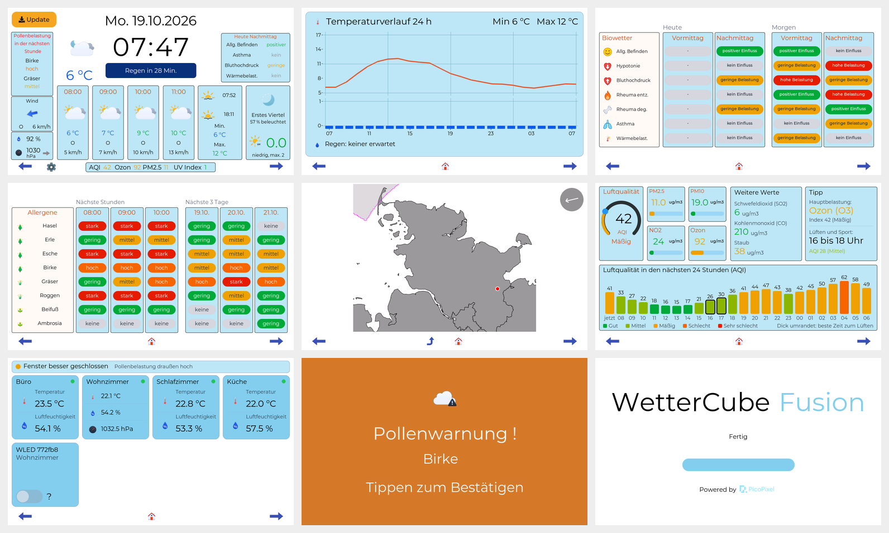
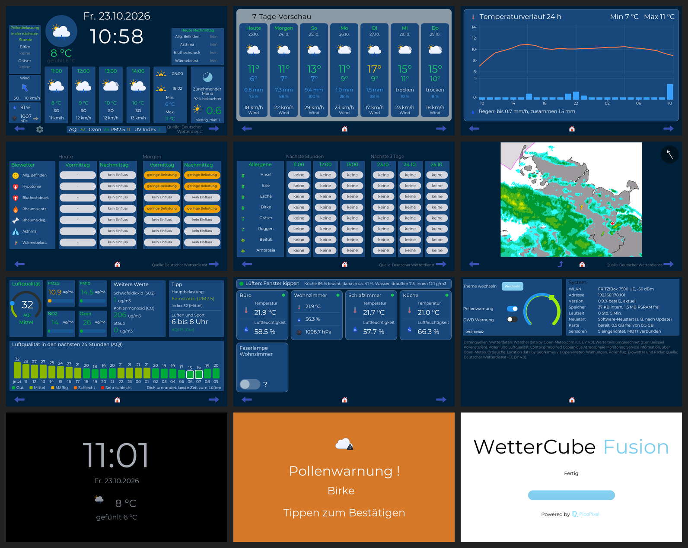

  <picture>
    <source media="(prefers-color-scheme: dark)" srcset="https://wettercube.de/wp-content/themes/wettercube/assets/images/wettercube-fusion-logo-hell.svg">
    
  </picture>

**Größer · Besser · Interne Umweltsensoren · MQTT ready · Inkl. aller WetterCubePlus-Funktionen**

*[English version below](#english)*

**WetterCube Fusion** ist die nächste Stufe der WetterCube-Familie: ein großes **7-Zoll-Wetterdisplay**, gebaut mit **ESP-IDF** für zwei Waveshare-Boards, das **ESP32-S3-Touch-LCD-7B** und das **ESP32-P4-WIFI6-Touch-LCD-7B** (je 1024×600, kapazitiver Touch). Es zeigt Wetter, DWD-Warnungen, Pollenflug und Biowetter und bringt Umweltsensoren, Home Assistant und MQTT mit. Die Wetterdaten kommen kostenlos von [Open-Meteo](https://open-meteo.com) und dem [Deutschen Wetterdienst (DWD)](https://www.dwd.de), ohne API-Key; Anzeige und Warnungen funktionieren derzeit nur auf Deutsch und in Deutschland.

> **🔓 Open Source (Apache 2.0):** Quellcode, Web-Installer und Firmware liegen in diesem Repository. Texte und Bilder: CC BY-NC 4.0, Bestandteile Dritter: [CREDITS.md](CREDITS.md), Name und Logos sind nicht freigegeben ([NOTICE](NOTICE)).
>
> **✅ Release Candidate:** Fusion läuft auf **zwei Boards**: dem **ESP32-P4** (empfohlen, zukunftssicher: mehr Leistung, animierte Symbole, Lautsprecher mit Timer und Warnton) und dem **ESP32-S3**. Beide haben dieselben Kernfunktionen, der Web-Installer wählt die passende Firmware.
>
> **⚠️ Nur auf Waveshare-Boards:** Unterstützt sind genau die beiden genannten Boards. Achte auf das **7-Zoll-Modell mit 1024×600 Pixeln** (die 800×480-Variante passt nicht) und beim S3 auf die **Touch-Ausführung** (es gibt das Board auch ohne Touch). Andere Boards werden nicht unterstützt.
>
> **💾 microSD-Karte nötig:** Verlauf, Log, Sicherung der Einstellungen und die Notfall-Kopie der Firmware liegen auf einer microSD-Karte (FAT32). Ohne Karte fehlen diese Funktionen.
>
> **🛠️ Softwareprojekt:** Das Gerät baust du selbst (Board kaufen, Firmware aufspielen, Gehäuse gestalten oder drucken), fertige Geräte gibt es nicht. Kurzanleitung: [Bauanleitung](https://wettercube.de/bauanleitung/).
>
> **⚖️ Auf eigene Gefahr:** Keine Haftung, siehe die [Nutzungshinweise](https://wettercube.de/nutzungshinweise/). Nicht für sicherheitskritische Zwecke einsetzen; beim Schalten von Steckdosen und Lampen ist Vorsicht geboten (Netzspannung). Fragen gern über das [Kontaktformular](https://wettercube.de/kontakt/) oder als [Issue](https://github.com/JPPeterson-lab/WetterCube-Fusion/issues).

## ✨ Das kann Fusion

- **Wetter, Gesundheit und Haus an einem Ort:** aktuelles Wetter, 4-Stunden-Vorhersage, 7-Tage-Vorschau, 24-Stunden-Verlauf mit Regenbalken, UV, Sonne und Mond, dazu Pollenflug, Biowetter und Luftqualität
- **DWD-Warnungen** mit Warnkarte und Niederschlagsradar
- **Zwei Standorte (nur P4):** zweiter Ort per Tipp auf dem Hauptscreen umschaltbar, zum Beispiel Wohnort und Ferienhaus
- **Eigene Sensoren und Lüften-Ampel:** Sensoren per MQTT/ESPHome oder intern im Gehäuse, Grenzwerte mit Alarm, Taupunkt- und Schimmelhinweis
- **Home Assistant und MQTT:** Anmeldung per Discovery, Schalter-Kacheln auf dem Display, `/api/status` als JSON
- **Handy-Nachrichten** über [ntfy](https://ntfy.sh), Nachtmodus nach Sonnenstand, Ruhezeit ohne Warnungen
- **Verlauf per Antippen und Next-Displays zentral:** Ein Tipp auf Temperatur, Luftdruck, Luftfeuchte oder eine Sensor-Kachel zeigt das Diagramm (24 Stunden, 7 oder 30 Tage). Alle Next-Displays stellst du unter `wettercube-next.local` in einem Reiter je Gerät ein.
- **Sicher und wartbar:** Update über WLAN oder Datei mit Rollback, Notfall-App am Display, Verlauf und Sicherungen auf der Speicherkarte
- **Lokal:** kein Konto, keine Cloud, deine Daten bleiben auf dem Gerät
- **Dazu das [WetterCube Next](https://github.com/JPPeterson-lab/WetterCube-Next):** ein kleines Zusatzdisplay für jeden Raum

## 📲 Installieren

1. Board per USB am Anschluss mit der Beschriftung **UART** anschließen, den **[Web-Installer](https://jppeterson-lab.github.io/WetterCube-Fusion/)** in Chrome oder Edge öffnen und installieren (das löscht den Flash, also auch Einstellungen und WLAN-Daten).
2. Mit dem WLAN **`WetterCube-Fusion-Setup`** verbinden und das eigene WLAN eintragen (das Passwort steht auf dem Display). Danach ist das Gerät unter `http://wettercube-fusion.local` erreichbar.
3. Updates später über die Update-Kachel am Gerät oder per Datei (`firmware.bin` aus den [Releases](https://github.com/JPPeterson-lab/WetterCube-Fusion/releases)).

**Selbst bauen** mit ESP-IDF 5.5: `bash build.sh` (bauen), `bash build.sh flash /dev/cu.xxx` (flashen), `TARGET=esp32p4 bash build.sh` (P4). Alle Einzelheiten stehen im [Wiki](https://wiki.wettercube.de/index.php/Fusion/Entwicklung).

## 📖 Mehr erfahren

| Wo | Was |
|---|---|
| **[wettercube.de](https://wettercube.de/projekte/wettercube-fusion/)** | Überblick, [Vergleich der Cubes](https://wettercube.de/vergleich/), [Roadmap](https://wettercube.de/roadmap/), [Bauanleitung](https://wettercube.de/bauanleitung/), [Hardware](https://wettercube.de/hardware/) |
| **[Wiki](https://wiki.wettercube.de/index.php/Fusion/Start)** | Inbetriebnahme, Einstellungen, alle Screens und Funktionen, Sensoren, Home Assistant, Updates, Wiederherstellung, Fehlersuche, Entwicklung |
| **[draussenwetter.de](https://draussenwetter.de/)** | Pollenflug und Biowetter für deinen Ort als Webseite, ohne Display |
| **[Vorstellungsvideo](https://youtu.be/aczE4MHxymY)** | der Fusion in gut fünf Minuten (YouTube) |
| **[Änderungsverlauf](CHANGELOG.md)** | was in welcher Version neu ist |

## 📡 Datenquellen

Wetter, Vorhersage, Pollen, Luftqualität und Ortssuche von [Open-Meteo.com](https://open-meteo.com) (CC BY 4.0; die kostenlose Schnittstelle ist nur für nicht-kommerzielle Nutzung gedacht). Pollen und Luftqualität stammen aus dem Copernicus-Dienst CAMS, die Ortssuche aus GeoNames. Warnungen, Pollenflug, Biowetter und Radar liefert der [Deutsche Wetterdienst](https://opendata.dwd.de) (CC BY 4.0, „Quelle: Deutscher Wetterdienst“). Die Werte werden teils umgerechnet. Einzelheiten und Lizenzen: [CREDITS.md](CREDITS.md).

## 🙏 Credits und Lizenz

  <a href="https://picopixel.io/de/"><picture>
    <source media="(prefers-color-scheme: dark)" srcset="https://community.picopixel.io/branding/pico_dark_logo.png">
    
  </picture></a>

> 💙 **Danke an PicoPixel:** Die LVGL-UI des Fusion wird mit [PicoPixel](https://picopixel.io/de/) erstellt, einem kostenlosen, browserbasierten Drag-and-Drop-Editor für LVGL. Das ist kein Werbe- und kein Affiliate-Link, ich verdiene nichts daran.

Bibliotheken, Icons und Schriften von Dritten (LVGL, ESP-IDF, Meteocons, Montserrat, ArduinoJson und weitere) behalten ihre eigenen Lizenzen, Einzelheiten in [CREDITS.md](CREDITS.md). Wetterdaten: „Weather data by [Open-Meteo.com](https://open-meteo.com)“ ([CC BY 4.0](https://open-meteo.com/en/licence); die kostenlose Schnittstelle ist **nur für nicht-kommerzielle Nutzung**, wer kommerziell einsetzt, braucht dort eine eigene Lizenz), im WetterCube teils umgerechnet (zum Beispiel zu Pollenstufen). Pollen und Luftqualität: „Contains modified Copernicus Atmosphere Monitoring Service information“, über Open-Meteo. Ortssuche: „Location data by [GeoNames](https://www.geonames.org) via Open-Meteo“. Warnungen, Pollenflug, Biowetter und Radar: [DWD Opendata](https://opendata.dwd.de) (CC BY 4.0, „Quelle: Deutscher Wetterdienst“).

| Was | Lizenz | Datei |
|---|---|---|
| **Quellcode, Firmware, Notfall-App, Werkzeuge** | Apache 2.0 | [LICENSE](LICENSE), [NOTICE](NOTICE) |
| **Texte, Bilder, Dokumentation** | CC BY-NC 4.0 | [LICENSE-Dokumentation.txt](LICENSE-Dokumentation.txt) |
| **Bestandteile Dritter** | eigene Lizenzen | [CREDITS.md](CREDITS.md) |

Du darfst den Quellcode nutzen, verändern und weitergeben, auch kommerziell; die Software wird ohne Gewähr bereitgestellt (Abschnitte 7 und 8 der Lizenz).

> **Versprechen:** Die private Nutzung von WetterCubePlus, Fusion und Next bleibt auch in Zukunft frei.

**Fehler und Wünsche:** gern als [Issue](https://github.com/JPPeterson-lab/WetterCube-Fusion/issues), am besten mit dem Text von `/log` (Web-Oberfläche → Log).

---

# WetterCube Fusion (English)

**WetterCube Fusion** is the next step of the WetterCube family: a large **7-inch weather display**, built with **ESP-IDF** for two Waveshare boards, the **ESP32-S3-Touch-LCD-7B** and the **ESP32-P4-WIFI6-Touch-LCD-7B** (each 1024×600, capacitive touch). It shows weather, DWD warnings, pollen forecast and Biowetter and adds environment sensors, Home Assistant and MQTT. Weather data comes for free from [Open-Meteo](https://open-meteo.com) and the [German Weather Service (DWD)](https://www.dwd.de), no API key; the display language and the warnings currently only work in German and in Germany.

> **🔓 Open source (Apache 2.0):** source code, web installer and firmware are in this repository. Texts and images: CC BY-NC 4.0, third-party components: [CREDITS.md](CREDITS.md), name and logos are not licensed ([NOTICE](NOTICE)).
>
> **✅ Release candidate:** Fusion runs on **two boards**: the **ESP32-P4** (recommended, future-proof: more power, animated icons, speaker with timer and warning tone) and the **ESP32-S3**. Both have the same core functions, the web installer picks the matching firmware.
>
> **⚠️ Waveshare boards only:** Exactly the two boards named above are supported. Make sure you get the **7-inch model with 1024×600 pixels** (the 800×480 variant does not fit) and, for the S3, the **touch version** (the board also exists without touch). Other boards are not supported.
>
> **💾 microSD card required:** history, log, settings backup and the emergency copy of the firmware live on a microSD card (FAT32). Without a card these functions are missing.
>
> **🛠️ Software project:** You build the device yourself (buy a board, flash the firmware, design or print a case); there are no finished devices. Short guide: [build guide](https://wettercube.de/en/build-guide/).
>
> **⚖️ At your own risk:** No liability, see the [usage notes](https://wettercube.de/en/usage-notes/). Do not use for safety-critical purposes; take care when switching sockets and lamps (mains voltage). Questions are welcome through the [contact form](https://wettercube.de/en/contact/) or as an [issue](https://github.com/JPPeterson-lab/WetterCube-Fusion/issues).

## ✨ What Fusion can do

- **Weather, health and home in one place:** current weather, 4-hour forecast, 7-day forecast, 24-hour curve with rain bars, UV, sun and moon, plus pollen, Biowetter and air quality
- **DWD warnings** with warning map and precipitation radar
- **Two locations (P4 only):** a second place switchable by a tap on the main screen, for example home and holiday home
- **Own sensors and ventilation traffic light:** sensors via MQTT/ESPHome or inside the case, limits with alarm, dew point and mold hint
- **Home Assistant and MQTT:** sign-up by discovery, switch tiles on the display, `/api/status` as JSON
- **Phone messages** via [ntfy](https://ntfy.sh), night mode by position of the sun, quiet hours without warnings
- **History by tapping, Next displays managed centrally:** tap temperature, air pressure, humidity or a sensor tile to see its chart (24 hours, 7 or 30 days). You set up all Next displays at `wettercube-next.local`, one tab per device.
- **Safe and maintainable:** update over Wi-Fi or from a file with rollback, recovery app on the display, history and backups on the memory card
- **Local:** no account, no cloud, your data stays on the device
- **Plus the [WetterCube Next](https://github.com/JPPeterson-lab/WetterCube-Next):** a small extra display for every room

## 📲 Installation

1. Connect the board via the USB port labelled **UART**, open the **[web installer](https://jppeterson-lab.github.io/WetterCube-Fusion/)** in Chrome or Edge and install (this erases the flash, including settings and Wi-Fi data).
2. Connect to the Wi-Fi **`WetterCube-Fusion-Setup`** and enter your own Wi-Fi (the password is shown on the display). Afterwards the device is reachable at `http://wettercube-fusion.local`.
3. Later updates through the update tile on the device or from a file (`firmware.bin` from the [releases](https://github.com/JPPeterson-lab/WetterCube-Fusion/releases)).

**Build it yourself** with ESP-IDF 5.5: `bash build.sh` (build), `bash build.sh flash /dev/cu.xxx` (flash), `TARGET=esp32p4 bash build.sh` (P4). All details are in the [wiki](https://wiki.wettercube.de/index.php/Fusion/Entwicklung).

## 📖 Learn more

| Where | What |
|---|---|
| **[wettercube.de](https://wettercube.de/en/products/wettercube-fusion/)** | overview, [comparison of the cubes](https://wettercube.de/en/comparison/), [roadmap](https://wettercube.de/en/roadmap/), [build guide](https://wettercube.de/en/build-guide/), [hardware](https://wettercube.de/en/hardware/) |
| **[Wiki](https://wiki.wettercube.de/index.php/Fusion/Start)** | getting started, settings, all screens and features, sensors, Home Assistant, updates, recovery, troubleshooting, development |
| **[draussenwetter.de](https://draussenwetter.de/)** | pollen and bio-weather for your location as a website, no display needed (German) |
| **[Introduction video](https://youtu.be/aczE4MHxymY)** | the Fusion in about five minutes (YouTube, German) |
| **[Changelog](CHANGELOG.en.md)** | what is new in which version |

## 📡 Data sources

Weather, forecast, pollen, air quality and location search from [Open-Meteo.com](https://open-meteo.com) (CC BY 4.0; the free interface is for non-commercial use only). Pollen and air quality come from the Copernicus service CAMS, the location search from GeoNames. Warnings, pollen forecast, bio-weather and radar are provided by the [German Weather Service](https://opendata.dwd.de) (CC BY 4.0, "Quelle: Deutscher Wetterdienst"). Values are partly converted. Details and licences: [CREDITS.md](CREDITS.md).

## 🙏 Credits and licence

  <a href="https://picopixel.io/"><picture>
    <source media="(prefers-color-scheme: dark)" srcset="https://community.picopixel.io/branding/pico_dark_logo.png">
    
  </picture></a>

> 💙 **Thanks to PicoPixel:** The LVGL UI of the Fusion is created with [PicoPixel](https://picopixel.io/), a free, browser-based drag-and-drop editor for LVGL. This is not an advertisement or affiliate link, I earn nothing from it.

Libraries, icons and fonts by third parties (LVGL, ESP-IDF, Meteocons, Montserrat, ArduinoJson and more) keep their own licences, details in [CREDITS.md](CREDITS.md). Weather data: “Weather data by [Open-Meteo.com](https://open-meteo.com)” ([CC BY 4.0](https://open-meteo.com/en/licence); the free interface is for **non-commercial use only**, anyone using the software commercially needs their own licence from them), partly converted by the WetterCube (for example to pollen levels). Pollen and air quality: “Contains modified Copernicus Atmosphere Monitoring Service information”, via Open-Meteo. Location search: “Location data by [GeoNames](https://www.geonames.org) via Open-Meteo”. Warnings, pollen forecast, bio-weather and radar: [DWD Opendata](https://opendata.dwd.de) (CC BY 4.0, “Quelle: Deutscher Wetterdienst”).

| What | Licence | File |
|---|---|---|
| **Source code, firmware, recovery app, tools** | Apache 2.0 | [LICENSE](LICENSE), [NOTICE](NOTICE) |
| **Texts, images, documentation** | CC BY-NC 4.0 | [LICENSE-Dokumentation.txt](LICENSE-Dokumentation.txt) |
| **Third-party components** | their own licences | [CREDITS.md](CREDITS.md) |

You may use, modify and share the source code, also commercially; the software is provided without warranty (sections 7 and 8 of the licence).

> **Promise:** Private use of WetterCubePlus, Fusion and Next stays free in the future.

**Bugs and wishes:** as an [issue](https://github.com/JPPeterson-lab/WetterCube-Fusion/issues), ideally with the text of `/log` (web interface → Log).

